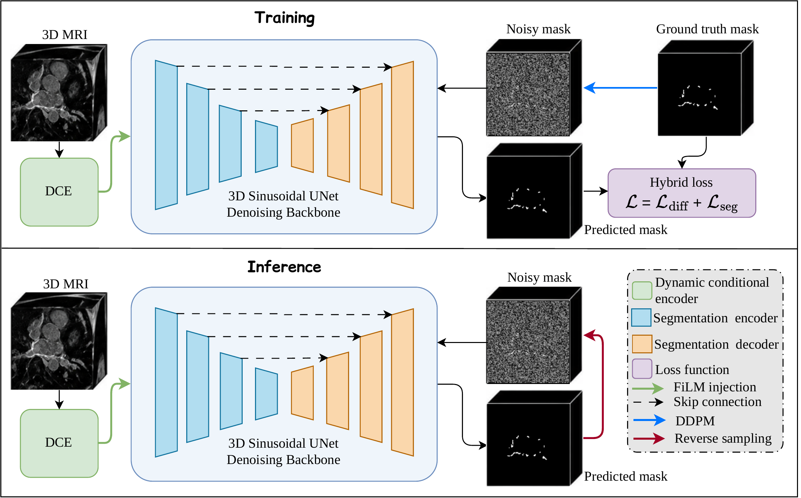

# CMDiff

**CMDiff is a 3D conditional diffusion framework for left atrial and scar segmentation from LGE-MRI, using a dynamic conditional encoder to guide clean-mask prediction.**

## Contents

1. [Method](#method)
2. [Repository contents](#repository-contents)
3. [Setup and data](#setup-and-data)
4. [Usage](#usage)
5. [Dataset references](#dataset-references)
6. [Citation](#citation)

## Method

[](assets/diffseg_model.pdf)

CMDiff predicts clean masks with a 3D sinusoidal U-Net conditioned on multiscale
LGE-MRI features from a dynamic conditional encoder (DCE). Training uses DDPM;
inference supports DDIM, DPM-Solver Multistep, Euler, and UniPC.
Click the figure for the original PDF.

## Repository contents

- **Training:** [`LA_diffusion.py`](code/LA_diffusion.py) and
  [`scar_diffusion.py`](code/scar_diffusion.py).
- **Evaluation:** [`LA_diffusion_evaluate.py`](code/LA_diffusion_evaluate.py) and
  [`scar_diffusion_evaluate.py`](code/scar_diffusion_evaluate.py); report Dice, HD95,
  ASD, and inference time.
- **Repeated sampling:**
  [`LA_diffusion_uncertainty_evalulate.py`](code/LA_diffusion_uncertainty_evalulate.py)
  and [`scar_diffusion_uncertainty_evaluate.py`](code/scar_diffusion_uncertainty_evaluate.py);
  export mean probability, standard deviation, variance, and entropy maps.

## Setup and data

Use Linux, Python 3.10 or compatible, and an NVIDIA GPU. Install a CUDA-compatible
PyTorch build, then the remaining dependencies:

```bash
python -m pip install monai diffusers SimpleITK numpy
```

Obtain LaScarQS from the [official website](https://zmiclab.github.io/projects/lascarqs22/)
using its [data access instructions](https://zmiclab.github.io/projects/lascarqs22/data.html).
Data are not included; follow the provider's data-use terms.

Prepare cropped, paired NIfTI images and five-fold JSON manifests:

- **LA:** `datalist_5fold.json`, with `image` and `label_LA` entries.
- **Scar:** `datalist_5fold_scar.json`, with `image` and `label_scar` entries.

Each fold contains `training` and `validation` lists; paths are relative to
`data_dir`. See [Detailed usage](docs/usage.md#data-preparation) for examples.

## Usage

Before running, edit each script's data/output paths, GPU selection, fold loop,
and checkpoint path. The released scripts retain experiment-specific settings.
For fresh LA training, set `resume = False` and `resume_epoch = 0`.
The training option `--save_dir` changes logs only; set `results_dir` in the script
for checkpoints. See [configuration details](docs/usage.md#configuration-required-before-running).

Run the required command from the repository root:

```bash
# Training (choose LA or scar)
python code/LA_diffusion.py
python code/scar_diffusion.py

# Segmentation evaluation
python code/LA_diffusion_evaluate.py
python code/scar_diffusion_evaluate.py

# Repeated-sampling analysis
python code/LA_diffusion_uncertainty_evalulate.py
python code/scar_diffusion_uncertainty_evaluate.py
```

Results are saved under `results_dir` as checkpoints, NIfTI predictions, logs,
and JSON metrics. Repeated-sampling dispersion describes prediction stability;
it is not a calibrated error probability. Use the matching held-out fold for
evaluation. Start with one case and a small sampling budget.

[Detailed usage](docs/usage.md) covers data examples, fold/checkpoint settings,
outputs, and reproducibility.

## Dataset references

Follow the dataset organisers' [citation guidance](https://zmiclab.github.io/projects/lascarqs22/faq.html):

1. Li et al. AtrialJSQnet: A New Framework for Joint Segmentation and Quantification of Left Atrium and Scars Incorporating Spatial and Shape Information. *Medical Image Analysis*, 76:102303, 2022.
   [Paper](https://www.sciencedirect.com/science/article/pii/S1361841521003480/).
2. Li et al. Medical Image Analysis on Left Atrial LGE MRI for Atrial Fibrillation Studies: A Review. *Medical Image Analysis*, 77:102360, 2022.
   [Paper](https://www.sciencedirect.com/science/article/abs/pii/S1361841522000135).
3. Li et al. AtrialGeneral: Domain Generalization for Left Atrial Segmentation of Multi-center LGE MRIs. *MICCAI 2021*, pp. 557-566, 2021.
   [DOI](https://doi.org/10.1007/978-3-030-87231-1_54).

Code: [MIT License](LICENSE). Research use only; not validated for clinical decisions.

## Citation

If you use this work, please cite:

```bibtex
@misc{zhang2026cmdiffleftatrialscar,
      title={CMDiff: Left Atrial Scar Segmentation from 3D LGE MRI Using Conditional Mask Diffusion Model: A Feasibility Study}, 
      author={Jing Zhang and Bastien Bergere and Jonas Leite and Emilie Bollache and Mikaël Laredo and Alban Redheuil and Nadjia Kachenoura},
      year={2026},
      eprint={2611.07814},
      archivePrefix={arXiv},
      primaryClass={cs.CV},
      url={https://arxiv.org/abs/2611.07814}, 
}
```
